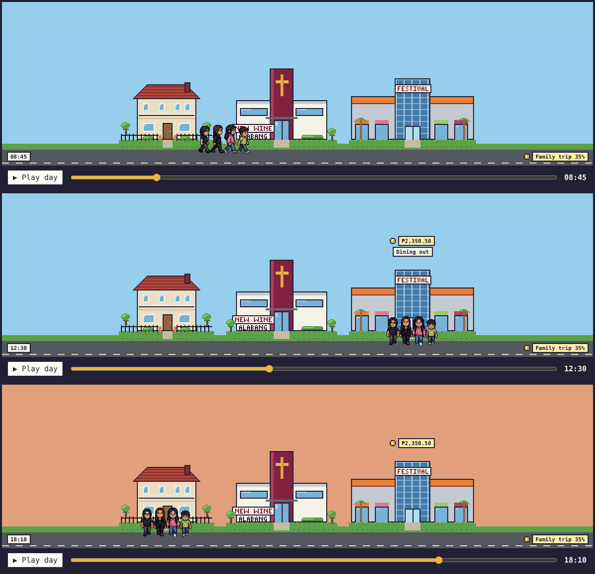

# Hesed Ultra

Our family's day in pixel art, plus budgeting and savings in pesos. The family and Claude (or other agents) can both add to it.



## What it does

- **Today:** log what everyone did and what was spent. The scene plays the day back: the family walks between home, church, school, the office and the malls, with spending shown above the place it happened.
- **Calendar:** each day shows the places visited, who was active, and what was spent.
- **Money:** monthly budgets per category with progress bars, income, spending and what is left.
- **Savings:** goals shown as jars that fill up.
- **Settings:** PINs, agent tokens, and a log of every change and who made it.

Parents (Freznel, Diane) can do everything. Children (Ellie, Rafa) can log their own activities and spending and see the family day and savings goals, but not budgets, settings or other people's spending.

## Run it on your computer

Needs Node.js 20+ and git.

```bash
cd "/Volumes/T7 Shield/Projects/Hesed_Ultra"
bash <(curl -fsSL https://raw.githubusercontent.com/freznel10/Hesed_Ultra/claude/keen-ride-0slm77/setup-local.sh)
npm run dev        # open http://localhost:5173
```

Data is stored in `.data/pglite` inside the project folder (not committed to git). On your own computer nobody needs a PIN: pick who you are on the first screen.

| Command | What it does |
|---|---|
| `npm run dev` | App, API and agent endpoint on http://localhost:5173 |
| `npm test` | All tests |
| `npm run typecheck` | TypeScript check |
| `npm run export -- backup.json` | Save all data to one file (keep it private: it holds PIN and token hashes) |
| `npm run import -- backup.json` | Load a backup into an empty database |
| `npm run art:places` | Redraw place sprites (`tools/gen_places.py`, needs Python 3 + Pillow) |
| `npm run art:characters` | Re-convert family sprites, walk frames and portraits from `assets/characters/reference/` |
| `npm run art:sync` | Copy sprites into `public/sprites/` for the app |

## Connect Claude

While the app is running:

```bash
claude mcp add --transport http hesed http://localhost:5173/mcp
```

Then ask things like "log that we had dinner at Festival Mall tonight, ₱2,350" or "how much is left for groceries this month?". Locally the agent acts as Freznel (change with `HESED_MCP_MEMBER`). Its changes appear in Settings → Recent changes as "claude (for freznel)".

Tools: `get_reference`, `get_day`, `get_calendar`, `log_activity`, `update_activity`, `delete_activity`, `log_expense`, `log_income`, `update_transaction`, `delete_transaction`, `get_month_summary`, `list_month_transactions`, `set_budget`, `list_goals`, `create_goal`, `add_savings`.

## Put it online (Netlify)

1. Create a Netlify site from this GitHub repo. `netlify.toml` already has the build settings.
2. Add a Postgres database: Netlify DB sets `NETLIFY_DATABASE_URL` for you (or set `DATABASE_URL` to any Postgres). Tables are created on first start.
3. In the site's environment variables set `SESSION_SECRET` (long random text) and `SETUP_CODE` (8+ characters). Without `SESSION_SECRET` the site locks itself instead of running unprotected.
4. Open the site, pick a parent, and sign in with the setup code. In Settings, set a PIN for everyone. The setup code stops working for a parent once they have a PIN.
5. To bring your local data along: `npm run export -- backup.json` locally, then `DATABASE_URL=<online url> npm run import -- backup.json` before step 4.
6. For Claude online: create a token in Settings, then
   `claude mcp add --transport http hesed https://<site>/mcp --header "Authorization: Bearer <token>"`.

## Layout

- `src/` — React app. `src/pages/` are the screens; `src/scene/` draws the day (`timeline.ts` decides where everyone is, `DayScene.tsx` draws it).
- `core/` — the rules: input checks (`schemas.ts`), activities, money, savings, change log (`audit.ts`), who may do what (`permissions.ts`, `service.ts`), PINs and tokens (`auth.ts`), local/online switch (`mode.ts`).
- `db/` — tables (`migrations.ts`, `schema.ts`), database connection (`client.ts`: PGlite locally, Postgres online), backup.
- `netlify/functions/` — `api.ts` (web API) and `mcp.ts` (agent endpoint). Both call `core/service.ts`.
- `mcp/tools.ts` — the agent tools.
- `assets/` — source art; `tools/` — art scripts. See [PLAN.md](PLAN.md) for the original plan and art notes.
