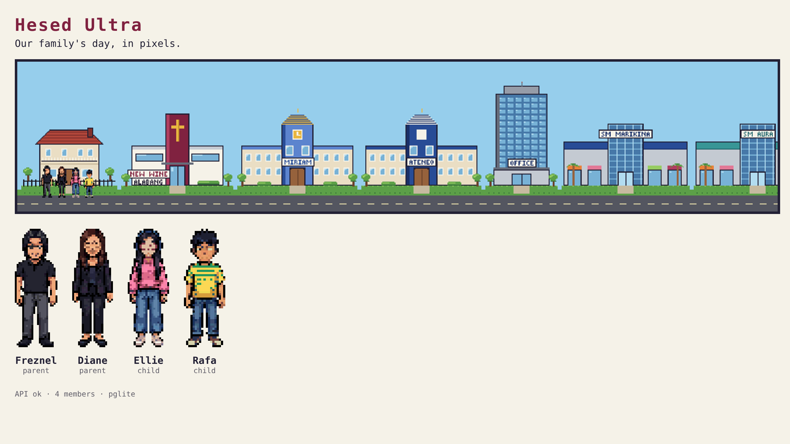

# Hesed Ultra

Our family's day in pixel art, plus budgeting and savings in pesos. See [PLAN.md](PLAN.md) for the full plan.



## Run it locally

Needs Node.js 20+ and git.

```bash
cd "/Volumes/T7 Shield/Projects/Hesed_Ultra"
bash <(curl -fsSL https://raw.githubusercontent.com/freznel10/Hesed_Ultra/claude/keen-ride-0slm77/setup-local.sh)
npm run dev        # open http://localhost:5173
```

Data is stored in `.data/pglite` inside the project folder (not committed to git).

| Command | What it does |
|---|---|
| `npm run dev` | App + API on http://localhost:5173 |
| `npm run dev:netlify` | Same, through the Netlify CLI (closer to production) |
| `npm test` | Unit tests |
| `npm run typecheck` | TypeScript check |
| `npm run db:seed` | Create/update the local database with the family, places and activities |
| `npm run art:places` | Redraw place sprites (`tools/gen_places.py`, needs Python 3 + Pillow) |
| `npm run art:characters` | Re-convert family sprites from `assets/characters/reference/` |
| `npm run art:sync` | Copy sprites into `public/sprites/` for the app |

## Layout

- `src/` — React app; `src/scene/` draws the town on a canvas
- `core/` — shared logic (money helpers, family/places/activities seed lists)
- `db/` — PGlite database, migrations, seed
- `netlify/functions/api.ts` — the API (`/api/health`, `/api/members`, `/api/places`, `/api/activity-types`)
- `assets/` — source art; `tools/` — art scripts
